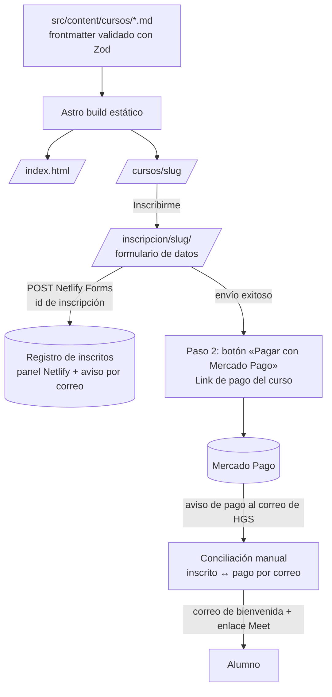

# Especificación Técnica de Arquitectura (Tech Spec)
## Proyecto: Landing de Cursos HGS
*Documento de Diseño Técnico | Versión: 0.2.0 | Basado en PRD: `specs/prd.md` | 2026-10-22*

---

## 1. Diagrama de Arquitectura y Flujo de Datos

Opción A (Link de pago) aprobada para la cohorte de diciembre 2026: sitio 100 % estático, sin funciones de servidor.



Conciliación: Mercado Pago no permite adjuntar una referencia por comprador a un Link de pago. El formulario pide **usar el mismo correo** en Mercado Pago, y el registro guarda el id de inscripción, la fecha y la hora para cruzar contra el panel.

---

## 2. Contratos de Datos y Esquemas de Entidades

### Entidad Principal: `Curso` (colección `cursos`, un archivo por curso)
```typescript
interface Curso {
  titulo: string;               // "Curso Completo de Pruebas de Bombeo"
  slug: string;                 // derivado del nombre de archivo
  resumen: string;              // ≤ 200 caracteres: tarjeta y meta description
  area: 'hidrogeologia' | 'geociencias';
  prerrequisitos: string[];     // slugs de otros cursos (vacío en la cohorte 2026-12)
  docentes: string[];           // ids de la colección `docentes`
  plataforma: 'google-meet';
  horas: number;
  semanas: number;
  software: { nombre: string; licencia: 'libre' | 'prueba' | 'comercial' }[];
  modulos: { titulo: string; contenido: string; entregable: string; horas?: number }[];
  figura: { src: string; alt: string };      // figura técnica real
  precioCLP: number;            // precio único, entero positivo
  mpLink: string;               // URL del Link de pago de Mercado Pago (https://mpago.la/… o link.mercadopago.cl/…)
  cohortes: Cohorte[];
  faq?: { pregunta: string; respuesta: string }[];
  resenas?: { nombre: string; cargo: string; fecha: string; texto: string; nota: 1|2|3|4|5 }[];
}

interface Cohorte {
  id: string;                   // "2026-12"
  inicio: string;               // ISO-8601 → "2026-12-07"
  termino: string;
  horario: string;              // "Lunes y miércoles 19:00–21:00 (hora de Chile)"
  cupos: number;
  estado: 'abierta' | 'agotada' | 'cerrada';
}

interface Docente {             // colección `docentes`
  id: string;                   // "elias-alvarado"
  nombre: string;
  titulo: string;               // profesión / cargo
  bio: string;                  // 2–3 líneas
  foto?: string;
  linkedin?: string;
}
```

Reglas de build:
- Una cohorte con `inicio` anterior a la fecha de build pasa a `cerrada`.
- Una ficha sin cohorte `abierta` no renderiza el flujo de pago (constitución §6).
- El build falla si `precioCLP` no es entero positivo, si `mpLink` no es una URL `https` de un dominio de Mercado Pago, o si un docente o prerrequisito apunta a un id inexistente.

### Formularios (Netlify Forms)
| Formulario | Campos | Validación |
|---|---|---|
| `inscripcion` | curso, cohorte, nombre, correo, país, profesión, empresa (opcional), id de inscripción (oculto, generado en cliente) | correo válido; aceptación de términos obligatoria |
| `informacion` | curso, nombre, correo, consulta | correo válido |
| `convenio` | curso, empresa/institución, nombre, correo, teléfono, n.º de participantes | participantes ≥ 6 |

Todos llevan campo *honeypot* anti-spam.

---

## 3. Integración Mercado Pago

| | **A. Link de pago** ✅ elegido | B. Checkout Pro (futuro) |
|---|---|---|
| Backend | Ninguno | 2 funciones serverless |
| Configuración | 1 link por curso (precio único) creado en el panel | Monto desde el archivo del curso |
| Asociar pago ↔ inscrito | Manual, por correo | Automática con `external_reference` |
| Migración | — | Cambiar `mpLink` por una llamada a función; el esquema no cambia |

---

## 4. Desglose de Componentes y Árbol de Archivos

| Operación | Ruta | Responsabilidad |
|---|---|---|
| `[NUEVO]` | `package.json`, `astro.config.mjs`, `netlify.toml` | Proyecto Astro, salida estática |
| `[NUEVO]` | `src/content/config.ts` | Esquemas Zod de `cursos` y `docentes` |
| `[NUEVO]` | `src/content/cursos/pruebas-de-bombeo.md`, `remociones-en-masa.md` | Catálogo (desde `specs/catalogo.md`) |
| `[NUEVO]` | `src/content/docentes/*.md` | Elías Alvarado, Gonzalo Suárez, Gonzalo Maragaño |
| `[NUEVO]` | `public/brand/*.svg`, `public/favicon.svg` | Logo (desde `brand/`) |
| `[NUEVO]` | `src/styles/tokens.css`, `src/styles/base.css` | Tokens de `design_spec.md` |
| `[NUEVO]` | `src/lib/formato.ts` | `formatoCLP`, `formatoFecha` (`Intl`, es-CL) |
| `[NUEVO]` | `src/layouts/Base.astro` | `<head>`, header, footer, un único `<main>` |
| `[NUEVO]` | `src/components/Header.astro`, `Footer.astro` | Navegación |
| `[NUEVO]` | `src/components/HeroParticulas.astro` | Isla canvas, carga diferida, fallback estático |
| `[NUEVO]` | `src/components/TarjetaCurso.astro` | Fila del explorador de cursos |
| `[NUEVO]` | `src/components/FichaHero.astro`, `Temario.astro`, `SubNav.astro`, `BarraInscripcion.astro` | Ficha de curso |
| `[NUEVO]` | `src/components/Formulario.astro` + `src/lib/formularios.ts` | Envío AJAX a Netlify Forms, estados de envío/éxito/error |
| `[NUEVO]` | `src/pages/index.astro` | Home |
| `[NUEVO]` | `src/pages/cursos/[slug].astro` | Ficha + JSON-LD `Course` |
| `[NUEVO]` | `src/pages/inscripcion/[slug].astro` | Formulario + paso de pago |
| `[NUEVO]` | `src/pages/convenios.astro` | Formulario de convenio |
| `[NUEVO]` | `src/pages/{terminos,privacidad}.astro` | Legales (retracto Ley 19.496) |

---

## 5. Notas de implementación (2026-10-22)

- **Astro 7.3.8** (fijado; 7.4.x tenía menos de 2 semanas). En Astro 7 las colecciones van en `src/content.config.ts` con `glob()` de `astro/loaders` y Zod 4 desde `astro/zod`.
- **Referencias rotas**: Astro 7.3 las registra como ERROR pero termina el build con código 0; `scripts/validar-contenido.mjs` las verifica en todo build.
- **Fuentes**: API de fuentes de Astro (`fontProviders.google()`), servidas desde el propio sitio. Precarga solo del subconjunto `latin` de display y cuerpo; `font-display: optional` en la monoespaciada (CLS 0).
- **CSS incrustado** en el HTML (`inlineStylesheets: 'always'`): 25 KB en total, sin petición bloqueante.
- **Figuras** (`GraficoLinea.astro`): SVG generado en el build desde `src/lib/hidro.ts`; capa de hover y teclado; tabla de datos.
- **Formularios**: AJAX a `/` (Netlify Forms) con `form-name`; `action` como respaldo sin JavaScript. Pago en `/inscripcion/<curso>/pago/`.

- **Vista previa (Bloque 7)**: GitHub Pages publica `build:borrador` con `HGS_BASE=/landing-cursos-hgs` y `PUBLIC_VISTA_PREVIA=1` (`.github/workflows/vista-previa.yml`). Toda ruta interna pasa por `ruta()` (`src/lib/rutas.ts`). Tema claro por defecto con selector; animación del hero con botón de pausa (WCAG 2.2.2).

## 6. Pendientes
- D-08 dominio y correo de HGS (necesarios para el aviso de formularios y para Mercado Pago).
- D-09 confirmar Netlify como hosting y proveedor de formularios.
- Datos ⏳ de `catalogo.md`: horas, horario, cupos, biografías, validación de temarios, Links de pago.
